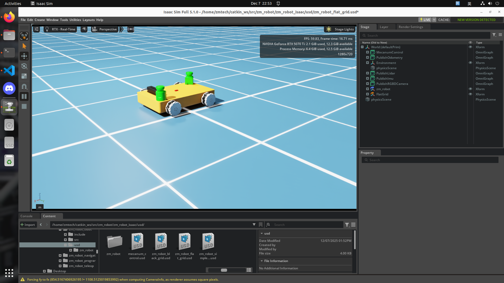
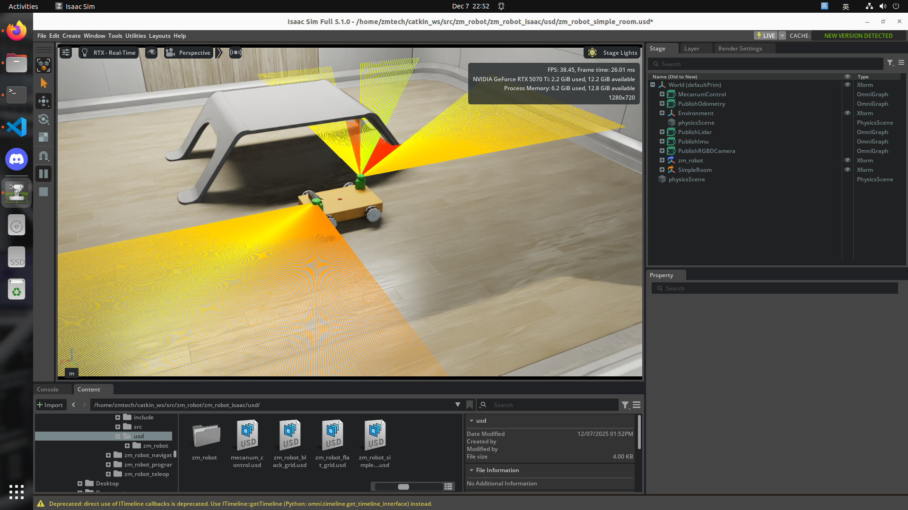
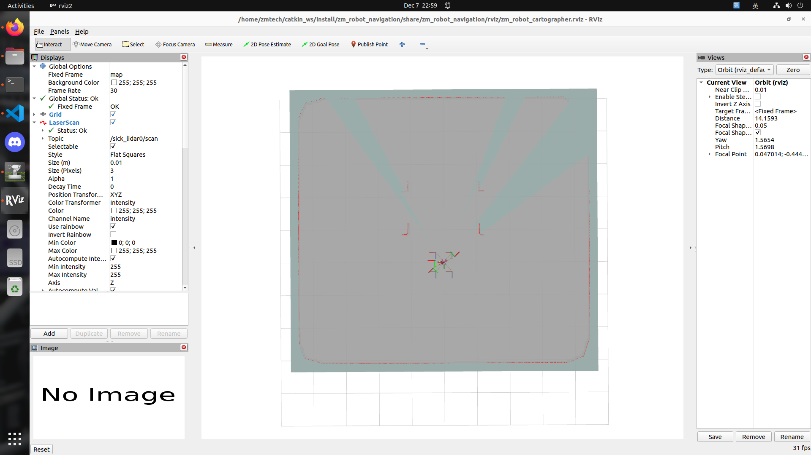
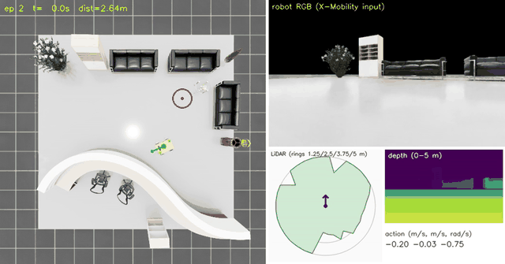
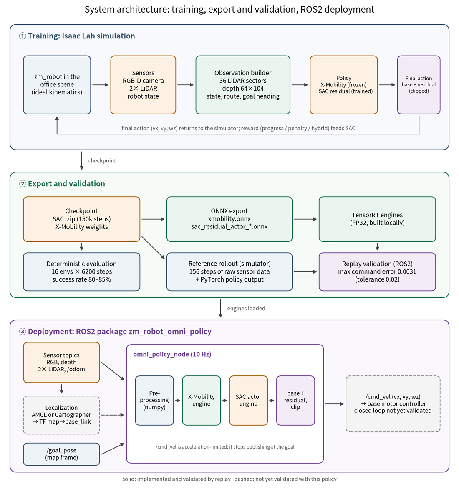
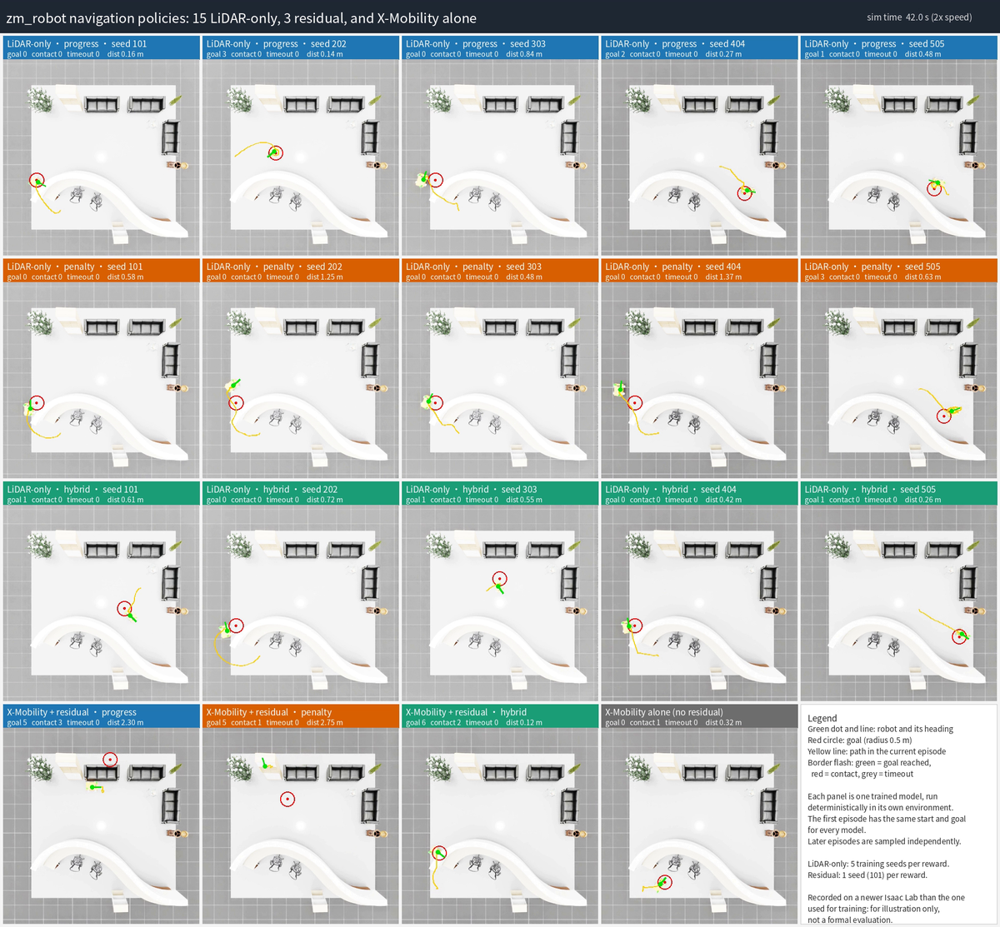
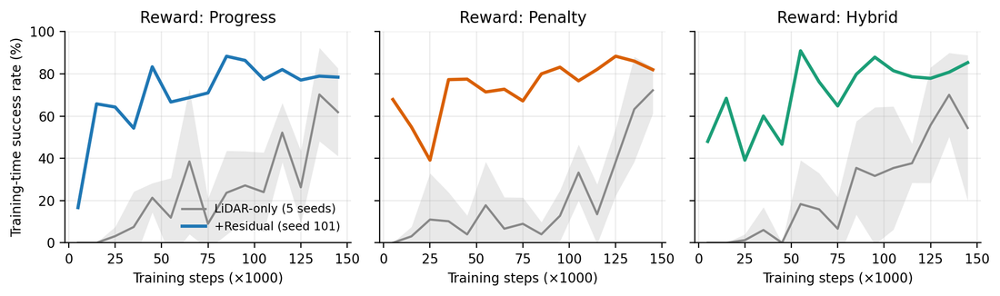
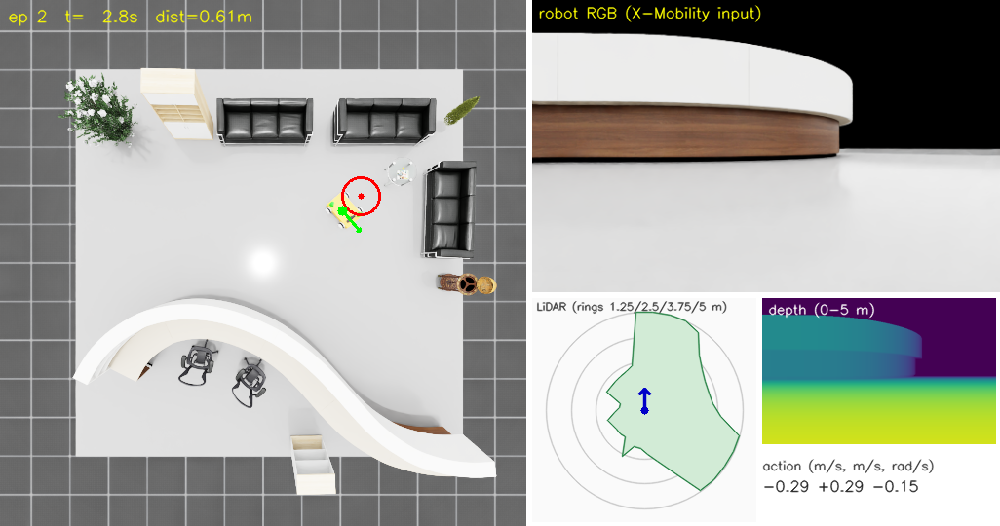

# zm_robot

The zm robot is a autonomous mobile robot by 4 mecanum wheel driving under NVIDIA isaac sim. It has two 2D-Lidar, RGB-D camera and Imu sensor. The purpose of this project is to make it easy for people to understand the control method of Omnidirectional Wheel and the establishment of mobile robots in the environment of ROS and NVIDIA isaac sim.

Navigation is done by a learned omnidirectional policy ([zm_robot_omni_policy](#omnidirectional-navigation-policy)) instead of Nav2: a frozen X-Mobility vision policy plus a residual trained with Soft Actor-Critic in NVIDIA Isaac Lab, deployed as a ROS 2 node with TensorRT.

------

## System Requirements

- OS : Ubuntu 24.04
- CPU : Intel Core i7 (7th Generation) / AMD Ryzen 5
- Cores : 4
- RAM : 32 GB
- Storage : 50GB SSD
- GPU : GeForce RTX 4080
- VRAM : 16GB
- Driver : Linux: 580.65.06

------

## Built with

- ROS Jazzy under Ubuntu 24.04 LTS

------

## Getting Started

### Installation

- Installation NVIDIA Isaac Sim

    - NVIDIA Isaac Sim Install - https://docs.isaacsim.omniverse.nvidia.com/5.1.0/installation/download.html

- Installation ros package.

    ``` $ sudo apt-get install ros-Jazzy-xacro```

    ``` $ sudo apt-get install -y ros-Jazzy-cartographer-ros ```
  
    ``` $ sudo apt-get install -y ros-jazzy-nav2-map-server ```

    ``` $ sudo apt-get install ros-jazzy-foxglove-msgs ```

- Installation NVIDIA VPI
    - NVIDIA VPI - https://docs.nvidia.com/vpi/installation.html

- For the navigation policy (`zm_robot_omni_policy`): TensorRT (with its Python bindings and `trtexec`) and pycuda.

    ``` $ pip3 install --break-system-packages pycuda ```

- For training the policy (`zm_robot_omni_training`): NVIDIA Isaac Lab - https://isaac-sim.github.io/IsaacLab/

### Run

- Open zm_robot_flat_grid.usd after launching NVIDIA Isaac Sim.



- This is a zm_robot control using a keyboard.

``` bash
$ ros2 run zm_robot_teleop zm_robot_teleop_key
```

- The zm_robot simple environment under NVIDIA Isaac Sim.




- The zm_robot create a map at simple room.

``` bash
$ ros2 launch zm_robot_navigation zm_robot_cartographer.launch.py
```



- Cartographer save map command.

``` bash
$ ros2 service call /write_state cartographer_ros_msgs/srv/WriteState "{filename : '${HOME}/zm_robot_cartographer_map.pbstream'}"
$ ros2 run nav2_map_server map_saver_cli -f ~/map
```

- The zm_robot navigation using cartographer localization and the omnidirectional navigation policy (replaces Nav2, see [Omnidirectional navigation policy](#omnidirectional-navigation-policy)).

``` bash
$ export ZM_ROBOT_OMNI_MODEL_DIR=<directory with the TensorRT engines>
$ ros2 launch zm_robot_navigation zm_robot_cartographer_omni_policy.launch.py
```

Send a goal with **2D Goal Pose** in RViz.



The policy driving zm_robot to a goal (recorded in Isaac Lab): top view, robot camera, LiDAR and depth input, and the command.

------

## Omnidirectional navigation policy

`zm_robot_omni_policy` drives zm_robot with all three degrees of freedom of the mecanum base (`linear.x`, `linear.y`, `angular.z`). It does not plan a path: it reads the camera, both LiDARs and the odometry, and steers towards the goal while avoiding obstacles.

```
final command (vx, vy, wz) = clip( X-Mobility command [vx, 0, wz] + SAC residual )
```

- **X-Mobility** (NVIDIA, frozen): a vision navigation policy trained on differential-drive robots. It sees the RGB image and outputs vx and wz only.
- **SAC residual** (trained here): sees X-Mobility's features and command, the 36-sector LiDAR ranges, a 64×104 depth image and the robot state, and adds a correction within ±50 % of the command range. All sideways motion comes from the residual.



| Package / folder | Contents |
| --- | --- |
| `zm_robot_omni_training` | Isaac Lab environment, SAC training, evaluation and ONNX export (not a ROS 2 package; `COLCON_IGNORE`) |
| `zm_robot_omni_policy` | ROS 2 package: `omni_policy_node` (TensorRT inference) and `replay_validation_node` |
| `zm_robot_navigation` | `zm_robot_cartographer_omni_policy.launch.py`: Cartographer localization + the policy + RViz |

### Results (simulation)

Deterministic evaluation in Isaac Lab, office scene, goals within 3 m, success = within 0.5 m and 0.5 rad of the goal pose and stopped.

| Policy | Success rate |
| --- | --- |
| X-Mobility alone | 14.0 % |
| SAC on LiDAR + robot state, trained from scratch (5 seeds per reward) | 21.9 – 37.8 % (mean per reward) |
| X-Mobility + SAC residual, progress / penalty / hybrid reward (1 seed each) | 80.4 % / 85.3 % / 82.9 % |



19 trained models side by side: 15 LiDAR-only SAC models (3 rewards × 5 seeds), the 3 residual models and X-Mobility alone.

### 1. Training (Isaac Lab)

The training code is in `zm_robot_omni_training` and runs with Isaac Lab's Python (`${ISAACLAB_PATH}/isaaclab.sh -p`). Extra packages are listed in `zm_robot_omni_training/requirements-extra.txt` (Stable-Baselines3, gin-config, diffusers).

- Get the X-Mobility weights: download `x_mobility-nav2-semantic_action_path.ckpt` from https://huggingface.co/nvidia/X-Mobility and extract the inference weights.

``` bash
$ cd zm_robot_omni_training
$ python3 scripts/extract_xmobility_weights.py --src <path>/x_mobility-nav2-semantic_action_path.ckpt
```

- Train the residual policy (150k steps, 16 parallel environments, ~16 GB GPU).

``` bash
$ ${ISAACLAB_PATH}/isaaclab.sh -p train_sac.py --obs state_lidar_xmob --reward hybrid --residual_scale 0.5 \
    --num_envs 16 --total_timesteps 150000 --seed 101 --run_name resid_hybrid_seed101 --headless --enable_cameras
```

`--obs state_lidar` without `--residual_scale` trains the LiDAR-only policy instead; `--reward` selects the goal-heading reward (`progress`, `penalty` or `hybrid`).



Training-time success rate: residual policy (coloured) against the LiDAR-only policy (grey, mean ± SD over 5 seeds).

- Evaluate (16 environments × 6200 steps, success rate with a 95 % confidence interval).

``` bash
$ ${ISAACLAB_PATH}/isaaclab.sh -p scripts/eval_sac.py --obs state_lidar_xmob --reward hybrid --residual_scale 0.5 \
    --num_envs 16 --steps 6200 --checkpoint logs/sb3/zm_robot_omni_sac_state_lidar_xmob/resid_hybrid_seed101/model_150000_steps.zip \
    --headless --enable_cameras
```

- Export to ONNX, and record a reference rollout for the ROS 2 validation.

``` bash
$ ${ISAACLAB_PATH}/isaaclab.sh -p scripts/export_deploy.py --out deploy_export \
    --checkpoint hybrid=logs/sb3/zm_robot_omni_sac_state_lidar_xmob/resid_hybrid_seed101/model_150000_steps.zip
$ ${ISAACLAB_PATH}/isaaclab.sh -p scripts/record_deploy_ref.py --reward hybrid --episodes 3 --out deploy_export/ref_hybrid.npz \
    --checkpoint logs/sb3/zm_robot_omni_sac_state_lidar_xmob/resid_hybrid_seed101/model_150000_steps.zip --headless --enable_cameras
```

These commands were run on Isaac Lab 3.0 (beta). Newer Isaac Lab releases need small compatibility changes, described in `zm_robot_omni_training/README.md`.

### 2. Model directory and TensorRT engines

Put the exported files in one directory (the models are not stored in this repository):

```
<model_dir>/
  xmobility.onnx
  sac_residual_actor_hybrid.onnx
  export_meta.json
  validation/ref_hybrid.npz
```

Build the TensorRT engines (once per machine, GPU and TensorRT version) and the ROS 2 package.

``` bash
$ zm_robot_omni_policy/scripts/build_engines.sh <model_dir>
$ cd ~/catkin_ws && colcon build --packages-select zm_robot_omni_policy zm_robot_navigation
$ export ZM_ROBOT_OMNI_MODEL_DIR=<model_dir>
```

### 3. ROS 2 validation

Replays the rollout recorded in Isaac Lab as ROS 2 topics (camera, depth, two LiDAR scans, odometry, TF, goal), step by step, and compares the `/cmd_vel` of `omni_policy_node` with the PyTorch policy.

``` bash
$ ros2 launch zm_robot_omni_policy replay_validation.launch.py
$ ros2 launch zm_robot_omni_policy replay_validation.launch.py mode:=realtime
```

The first command checks every step; the second runs the node on its 10 Hz timer and checks the command rate and the stop when the sensors go silent.

| Check | Result |
| --- | --- |
| `/cmd_vel` vs PyTorch policy (147 of 156 steps) | max difference 0.0031 (m/s, rad/s) |
| Pre-processed observations vs Isaac Lab observations | ≤ 1e-6 |
| Inference time (pre-processing + 2 engines, RTX 5070 Ti) | about 10 ms |
| 10 Hz timer mode | 9.8 Hz; zero velocity when the sensors stop |

The 9 excluded steps are the first steps of each episode, where Isaac Lab's own observation is not self-consistent (see `zm_robot_omni_policy/README.md`).



Recorded episode: top view (green: robot and heading, red circle: goal), robot RGB camera, 36-sector LiDAR and depth image, and the command (vx, vy, wz).

### 4. Navigation in Isaac Sim

``` bash
$ ros2 launch zm_robot_navigation zm_robot_cartographer_omni_policy.launch.py
```

| Argument | Default | Description |
| --- | --- | --- |
| `actor` | `hybrid` | residual model: `hybrid`, `penalty` or `progress` |
| `max_linear_x` / `max_linear_y` / `max_angular_z` | 0.6 / 0.6 / 1.57 | limits of `/cmd_vel` (m/s, m/s, rad/s) |
| `configuration_basename` | `zm_robot_lds_2d.lua` | `zm_robot_lds_2d_localization.lua` for Cartographer pure localization |

- `/cmd_vel` is limited to 2.0 m/s² and 3.14 rad/s², the same acceleration limits as in training.
- On reaching the goal (0.5 m, 0.5 rad) the node ramps down to zero and stops publishing `/cmd_vel` until a new goal arrives.
- There is no global planner or costmap: goals should be within about 3 m (the training range) and reachable without a long detour.
- Closed-loop driving in Isaac Sim is still being tested; the results above come from Isaac Lab and from the ROS 2 replay.

| Topic | Description |
| --- | --- |
| /goal_pose | goal for the policy (`geometry_msgs/PoseStamped`, `map` frame). |
| /emergency_stop | `std_msgs/Bool`; while true the policy publishes zero velocity. |
| /zm_robot_omni_policy/debug | per-step policy inputs and outputs (`std_msgs/Float32MultiArray`). |

------

## zm_robot topic

| Topic                              | Description                                                       |
| ---                                | ---                                                               | 
| cmd_vel                            | zm_robot input to move velocity.                                  |
| joint_states                       | zm_robot joint status topic.                                      |
| odom                               | zm_robot odomentry topic.                                         |
| sick_lidar0/scan                   | sick laser1 Laserscan.                                            |
| sick_lidar1/scan                   | sick laser2 Laserscan.                                            |
| kinect_v2/color/image_raw          | Kinect V2 RGB image.                                              |
| kinect_v2/depth/image_raw          | Kinect V2 Depth image.                                            |
| imu                                | zm_robot IMU sensor.                                              ||

------

## 🎬 Simulation Demo (YouTube)

Click the image below to watch the demo video:

[](https://youtu.be/rabQwstnbsQ)

[](https://youtu.be/QpQLJSyjY1c)

[](https://youtu.be/EszqV1yoW10)


------

## History:

| Branch         | Description                                                                     | File Creation |
| ---            | ---                                                                             | ---           |
| ros1-original  | zm_robot original version.                                                      | July, 2020.   |
| ros1           | zm_robot ros1 version for zm_robot programing simply.                           | July, 2021.   |
| ros1-main      | zm_robot ros1-main version add safety function           .                      | August, 2021. |
| ros1-pid       | zm_robot ros1-pid version using PID controller for zm_robot programing simply.  | July, 2021.   |
| ros2-foxy      | zm_robot ros2 versoin under ROS 2 Foxy environment.                             | August, 2021. |
| ros2-jazzy     | zm_robot ros2 versoin under ROS 2 Jazzy environment.                            | February, 2025.   |
| ros2-isaac-sim | zm_robot ros2 versoin under ROS 2 Jazzy and NVIDIA isaac sim                    | February, 2026.   |
| ros2-isaac-lab-policy | zm_robot ros2 version with an omnidirectional navigation policy (X-Mobility + SAC residual) trained in NVIDIA Isaac Lab, replacing Nav2 | November, 2026.   ||

------

## Reference:

[1]. turtlebot3_teleop. https://github.com/ROBOTIS-GIT/turtlebot3/tree/master/turtlebot3_teleop

[2]. Isaacsim ROS2 tutorial. https://docs.isaacsim.omniverse.nvidia.com/5.1.0/ros2_tutorials/index.html

[4]. Cartographer ROS2. https://ros2-industrial-workshop.readthedocs.io/en/latest/_source/navigation/ROS2-Cartographer.html

[5]. navigation2. https://github.com/ros-planning/navigation2

[6]. Isaac ROS. https://nvidia-isaac-ros.github.io/index.html

[7]. COMPASS: Cross-embOdiment Mobility Policy. https://nvlabs.github.io/COMPASS , https://arxiv.org/abs/2502.16372

[8]. X-Mobility. https://github.com/NVlabs/X-MOBILITY

[9]. Isaac Lab. https://isaac-sim.github.io/IsaacLab/

[10]. Stable-Baselines3 (Soft Actor-Critic). https://github.com/DLR-RM/stable-baselines3

------

This repository is for your reference only. copying, patent application, academic journals are strictly prohibited.

Copyright © 2026 ZM Robotics Software Laboratory.
